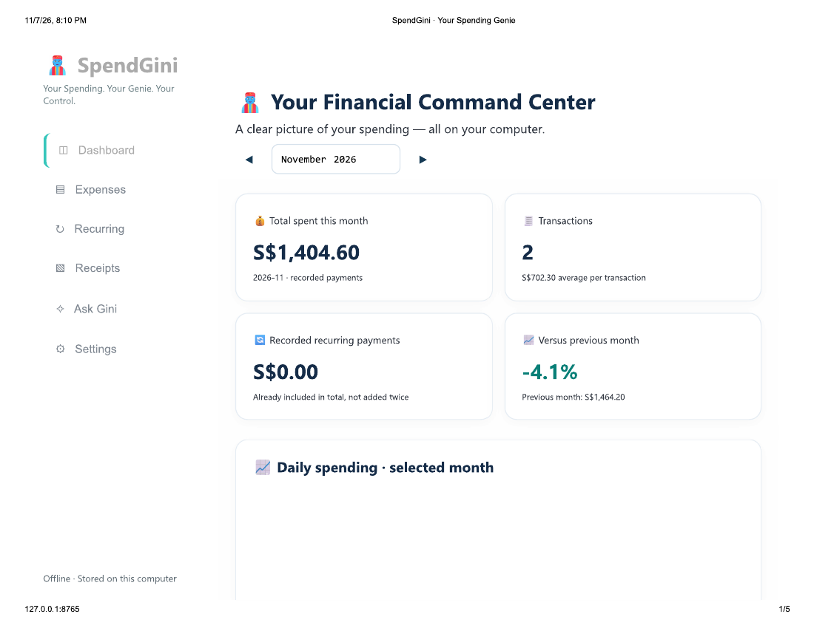
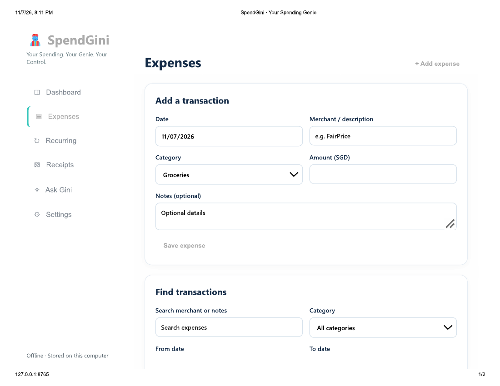
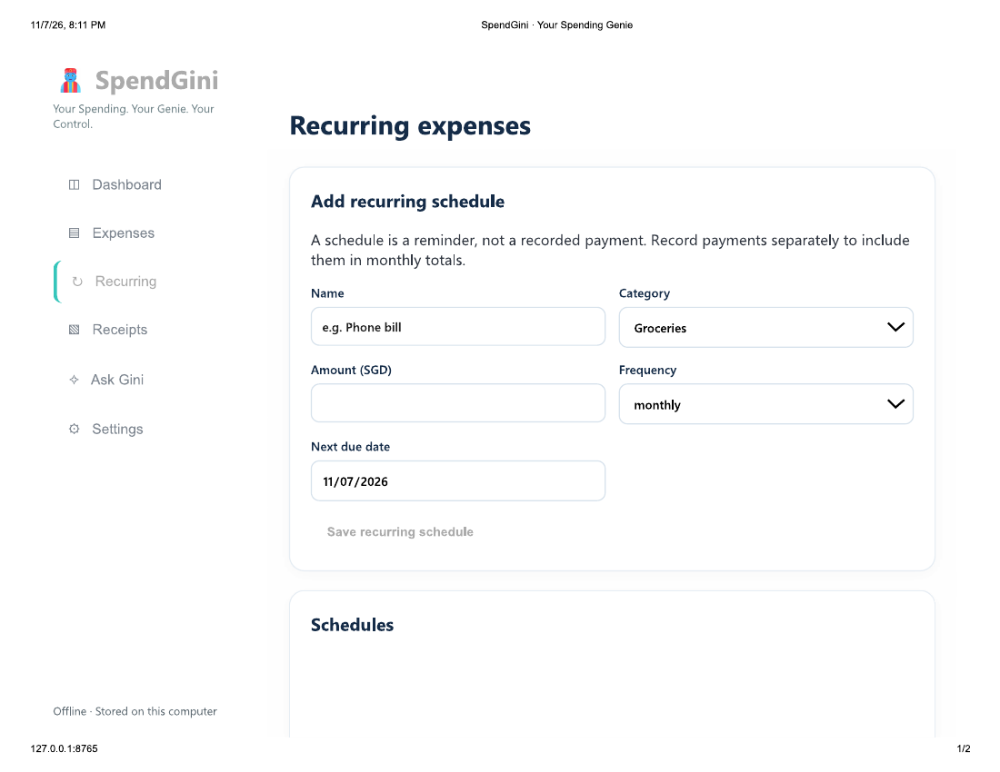
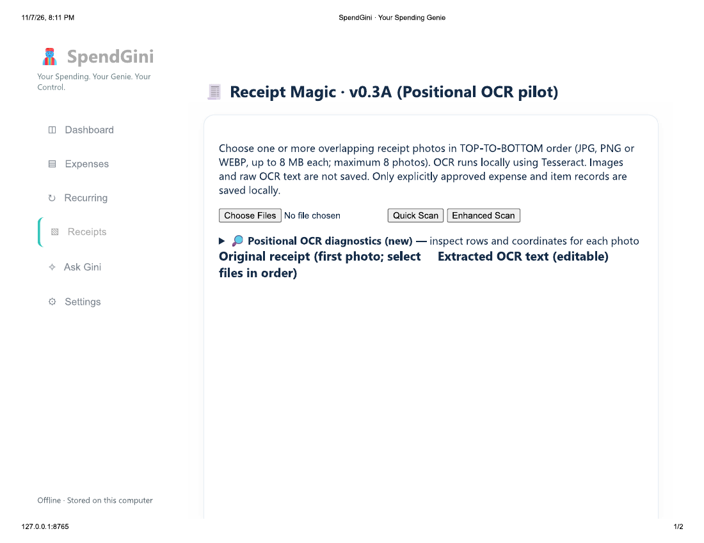
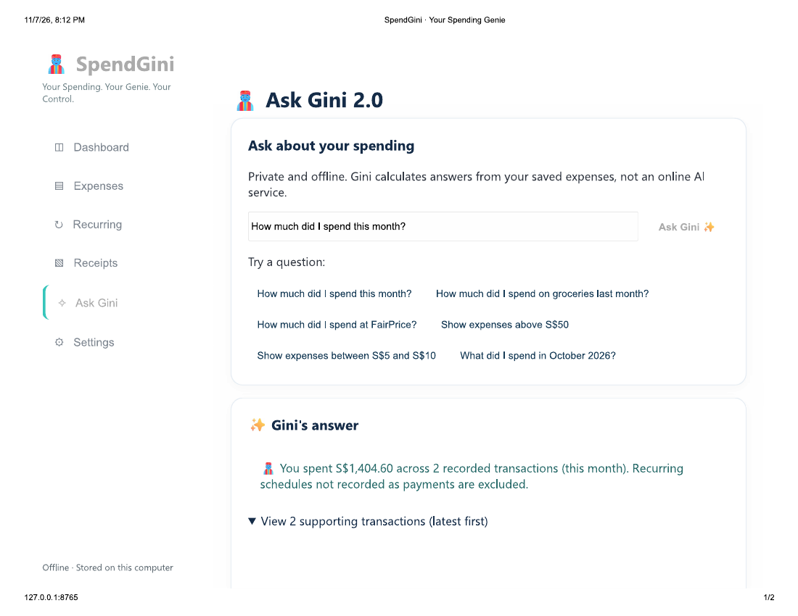

# 🧞 SpendGini
### Your Spending. Your Genie. Your Control.

**A privacy-first, offline personal expense tracking and spending intelligence application.**




---

## 📌 Project Overview

SpendGini is an independently developed personal expense management application designed to help individuals record, organize, analyze, and better understand their spending.

The application combines traditional expense tracking with interactive analytics, receipt processing, recurring expense management, and an offline natural-language spending assistant called **Ask Gini**.

Unlike cloud-dependent financial applications, SpendGini is designed to operate locally, giving users greater control over their financial information.

**Project Type:** Independent Application Development  
**Development Status:** Active Development / Prototype  
**Source Code:** Private — Not Published

> **Note:** This repository is a project showcase containing application screenshots, documentation, and a presentation. It does not contain source code, executable files, financial databases, or personal receipt data.

---

## 🎯 Problem Statement

Managing personal expenses can be challenging because:

- Spending information is scattered across receipts, transactions, and recurring bills.
- Manual expense recording can be repetitive.
- Paper receipts contain useful item-level information that is difficult to organize.
- Users often struggle to identify spending patterns and unusual expenses.
- Many financial applications depend on cloud services or external integrations.

SpendGini explores how these challenges can be addressed through a privacy-first application combining expense management, analytics, and local automation.

---

## ✨ Core Features

### 1. Financial Command Center

An interactive dashboard providing a consolidated view of recorded expenses.

**Capabilities include:**
- Monthly spending totals and transaction counts.
- Month-over-month spending comparisons.
- Daily and six-month spending trends.
- Spending breakdowns by category.
- Top merchants by spending.
- Monthly spending briefings and insights.
- Unusual transaction alerts.
- Potential savings opportunities.
- Upcoming recurring payment commitments.


### 2. Expense Management

Record and maintain expenses through a structured transaction management interface.

**Capabilities include:**
- Add, edit, and delete expenses.
- Categorize transactions.
- Search by merchant or notes.
- Filter by category and date.
- Sort transactions by date or amount.
- Export expense records to CSV.



### 3. Recurring Expenses and Subscriptions

Manage recurring financial commitments such as utilities, subscriptions, and other regular payments.

**Capabilities include:**
- Monthly, quarterly, and yearly schedules.
- Upcoming payment dates.
- Scheduled commitment amounts.
- Separate tracking of scheduled and recorded payments.

A recurring schedule is treated as a reminder. It is **not automatically counted as a paid expense**, helping prevent double-counting.



### 4. Receipt Magic — Local OCR Pilot

Receipt Magic explores the conversion of photographed paper receipts into structured expense records.

**Capabilities include:**
- Local receipt text extraction using Tesseract OCR.
- Quick and enhanced scanning modes.
- Support for multiple receipt photographs.
- Suggested merchant, date, total, and item details.
- Editable extracted information.
- Item-level expense recording.
- Receipt-total reconciliation and review indicators.
- Explicit user verification before saving.



**Current limitation:** Receipt Magic remains an experimental capability. Complex, lengthy, or overlapping receipt photographs may require substantial manual correction.

### 5. Ask Gini — Offline Spending Assistant

Ask Gini allows users to explore their recorded expenses using supported natural-language questions.

Example questions:

- How much did I spend this month?
- How much did I spend on groceries last month?
- How much did I spend at a particular merchant?
- Show expenses above S$50.
- Show expenses between S$5 and S$10.

The assistant calculates answers from locally recorded expenses and can display supporting transactions.



**Technical clarification:** Ask Gini currently uses deterministic, rule-based question interpretation. It is not a cloud-based generative AI chatbot or a large language model.

---

## 🏗️ Application Architecture

SpendGini follows a local application architecture:

```text
                  USER
                    |
                    v
          Browser-Based Interface
           HTML / CSS / JavaScript
                    |
                    v
            Local Python Server
               127.0.0.1
                    |
          +---------+---------+
          |                   |
          v                   v
     Application          Receipt OCR
       Logic              Processing
          |                Tesseract
          |
          v
     SQLite Database
    Local Expense Data
          |
          v
    Spending Analytics
       & Ask Gini
```

The application is designed to operate on the user's computer without external financial-data APIs.

### Technology Stack

| Component | Technology |
|---|---|
| Application Backend | Python |
| User Interface | HTML, CSS, JavaScript |
| Local Web Server | Python HTTP Server |
| Database | SQLite |
| Receipt Recognition | Tesseract OCR |
| Image Processing | Pillow |
| Analytics | Python and JavaScript |
| Natural-Language Queries | Rule-Based Interpretation |
| Target Environment | Windows |

---

## 🔒 Privacy and Data Management

Privacy is a central design objective.

SpendGini:
- Stores recorded expenses in a local SQLite database.
- Runs its application server on the local loopback interface.
- Does not require a cloud account.
- Does not use an external AI service for Ask Gini.
- Processes receipt images locally.
- Supports exporting expense records to CSV.

**Security limitation:** The current prototype does not implement application-level database encryption or password authentication. Device security and appropriate backup practices remain important.

Offline operation should not be interpreted as a guarantee of complete data security.

---

## 🚧 Development Status and Roadmap

| Capability | Status |
|---|---|
| Expense Recording and Management | Implemented |
| Spending Dashboard | Implemented |
| Spending Insights and Alerts | Implemented |
| Recurring Expense Schedules | Implemented |
| Ask Gini — Supported Spending Queries | Implemented |
| CSV Export | Implemented |
| Receipt Magic — OCR and Verification | Experimental |
| Complex Multi-Photo Receipt Reconstruction | Improvement Backlog |
| Budget Planning and Tracking | Deferred |
| Expanded Ask Gini Capabilities | Planned |
| Further Testing and Stability Improvements | Ongoing |

*Implementation status reflects the current private prototype; it does not imply production certification or comprehensive independent testing.*

---

## 📚 Project Documentation

The following documents provide additional information about SpendGini:

| Document | Description |
|---|---|
| [Project Documentation](documentation/SpendGini_Project_Documentation.pdf) | Business problem, objectives, architecture, features, limitations, and roadmap |
| [User Manual](documentation/SpendGini_User_Manual.pdf) | Step-by-step application usage instructions |
| [Project Presentation](documentation/SpendGini_Project_Presentation.pdf) | Visual overview of the application and its capabilities |

---

## 💡 Key Project Takeaways

Developing SpendGini demonstrates the integration of several disciplines:

**Application Development:** Designing and implementing a functional local application.

**Data Management:** Structuring transaction, receipt-item, and recurring-expense records.

**Analytics and Visualization:** Transforming expense data into understandable financial insights.

**Automation:** Exploring local receipt recognition and structured information extraction.

**Human-Centered Design:** Providing understandable interfaces and requiring user verification for uncertain OCR results.

**Privacy-Aware Engineering:** Designing around local storage and minimizing reliance on external services.

**Iterative Development:** Building, testing, refining, and prioritizing features through successive prototype versions.

---

## 👨‍💻 Project Ownership

**Independent Project — Application Concept, Design, Development, and Testing**

This project is part of my broader portfolio exploring how analytics, automation, and software development can be combined to solve practical problems.

The application is under active development, and its source code remains private.

---

### 🧞 SpendGini
**Your Spending. Your Genie. Your Control.**
